# Naru 复现：结果整理（组内用）

更新：2026-11-11。这份文档给组员写正式报告时参考，不是最终报告。图在 `figures/`（PNG + PDF），每张图实际画出来的数字在 `analysis/tables/<图名>.csv`，脚本是 `analysis/make_figures.py`，一条命令重建：

```bash
python analysis/make_figures.py   # 需要 matplotlib、numpy、pandas；只读 experiments/ 和 data/
```

## 0. 待组员补充

| 项目 | 内容 |
|---|---|
| 成员姓名、本科专业 | TODO |
| 分工 / 贡献 | TODO |
| 视频链接 | TODO（课程要求 5–8 分钟，讲义写 8–10 分钟，录之前再确认） |
| 提交截止 | 2026-12-06 23:59（北京时间），报告文件名 `XXXX-report.pdf` |

## 1. 实验设置（报告里可直接用）

- **数据**：纽约州 DMV 车辆登记表，2026-11-03 版快照，12,540,479 行，论文同款 11 列。原论文链接的快照已失效，所以不能和论文数字直接比较。评估三个规模：前 1M、前 5M 和全表（嵌套子集）。
- **模型**：自写 MADE、自写 ResMADE、官方 ResMADE（上游代码 commit 264cf4e）。宽度 256，5 层，batch 2048，20 epochs，warmup 8000，3 个训练 seed（0/1/2），不早停也不挑 seed。
- **推理**：progressive sampling 2000 个样本；ResMADE 开启 wildcard skipping。
- **基线**：精确边际独立假设、10k 行均匀采样、与自写 ResMADE 参数字节数相同的均匀采样（storage-matched），以及 PostgreSQL 17.6 的三种配置（默认 stat 100、stat 1000、stat 1000 加扩展统计）。
- **负载**：主负载每个规模 2000 条，按官方生成器的方式造查询（以随机行为锚点，5–11 个谓词）。补充负载有 shared 1000、predicate sweep 1100、stress v2 300，以及 joint-zero 100 对。
- **指标**：q-error = max(max(1,真值)/max(1,估计), max(1,估计)/max(1,真值))。每个 seed 先在全部查询上算分位数，再取 3 个 seed 的中位数，误差条是 min–max。**这个范围不是置信区间**，报告里不要写成 95% CI。

## 2. 主要结论

1. **学习型模型把尾部误差降了 1–3 个数量级。** 全表 p99：三个模型在 1.62–1.73 之间；独立假设是 581，10k 均匀采样是 1476，PG 默认配置是 598。
2. **自写 ResMADE 与官方实现基本一致。** 同一查询、同一 seed 逐条配对，log10(自写/官方) 的中位数在 −0.0005 到 −0.0003 之间，自写更准的比例为 51%–54%（图 4）。
3. **ResMADE 并不总比 MADE 好。** 大多数中位数和 p95 格子里 MADE 略优，比如全表 p95 是 1.166 对 1.191。报告里不要写“ResMADE 更强”。
4. **最强的传统基线是 PG 加扩展统计和同存储采样。** 全表 p95 分别为 2.62 和 2.00，差距比独立假设小得多，但 p99（13.4、37.0）仍比模型高一个数量级以上。
5. **代价**：模型约 5.8–7.8 MB 参数，单查询 GPU 推理约 15–18 ms；PG 统计只有几 KB，规划时间低于 0.1 ms（图 6）。两者设备和计时边界都不同，只能说明量级，不能当加速比。

### 主表（主负载，3 seed 中位数）

| 规模 | 方法 | median | p95 | p99 |
|---|---|---:|---:|---:|
| 1M | 自写 MADE | 1.046 | 1.399 | 2.294 |
| 1M | 自写 ResMADE | 1.054 | 1.463 | 2.197 |
| 1M | 官方 ResMADE | 1.060 | 1.462 | 2.330 |
| 1M | 同存储均匀采样 | 1.014 | 1.764 | 6.000 |
| 1M | PG stat1000 + 扩展统计 | 1.087 | 2.772 | 7.502 |
| 1M | PG 默认 | 1.297 | 17.01 | 314.6 |
| 1M | 独立假设 | 1.243 | 17.00 | 294.7 |
| 1M | 10k 均匀采样 | 1.063 | 28.05 | 124.0 |
| 5M | 自写 MADE | 1.017 | 1.283 | 2.000 |
| 5M | 自写 ResMADE | 1.025 | 1.295 | 2.000 |
| 5M | 官方 ResMADE | 1.028 | 1.300 | 2.006 |
| 5M | 同存储均匀采样 | 1.015 | 2.458 | 23.02 |
| 5M | PG stat1000 + 扩展统计 | 1.087 | 2.912 | 9.751 |
| 5M | PG 默认 | 1.281 | 20.67 | 558.0 |
| 5M | 独立假设 | 1.231 | 19.78 | 547.1 |
| 5M | 10k 均匀采样 | 1.065 | 126.2 | 635.1 |
| 全表 | 自写 MADE | 1.017 | 1.166 | 1.622 |
| 全表 | 自写 ResMADE | 1.021 | 1.191 | 1.621 |
| 全表 | 官方 ResMADE | 1.023 | 1.196 | 1.734 |
| 全表 | 同存储均匀采样 | 1.016 | 2.000 | 37.00 |
| 全表 | PG stat1000 + 扩展统计 | 1.084 | 2.616 | 13.39 |
| 全表 | PG 默认 | 1.277 | 28.03 | 598.4 |
| 全表 | 独立假设 | 1.226 | 26.46 | 581.0 |
| 全表 | 10k 均匀采样 | 1.066 | 393.3 | 1476 |

PG stat 1000（不加扩展统计）和 PG 默认差不多，完整数字见 `analysis/tables/fig02_main_accuracy.csv`。

## 3. 正文图

**图 1 训练曲线**：三个规模、三种模型的每轮训练 NLL。注意 ResMADE 的 loss 里含随机列遮盖，和 MADE 的目标函数不同，两族曲线不能直接比高低。

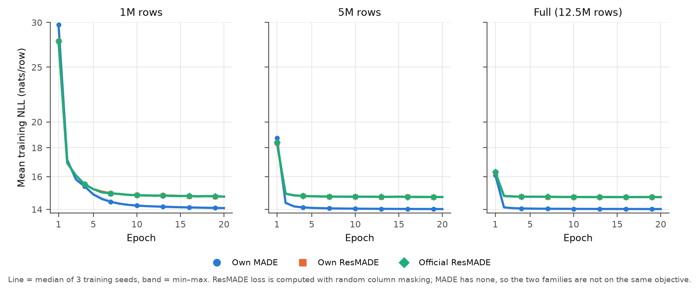

**图 2 主负载精度**：所有方法的 median / p95 / p99，对数坐标。竖线左边是三个模型。

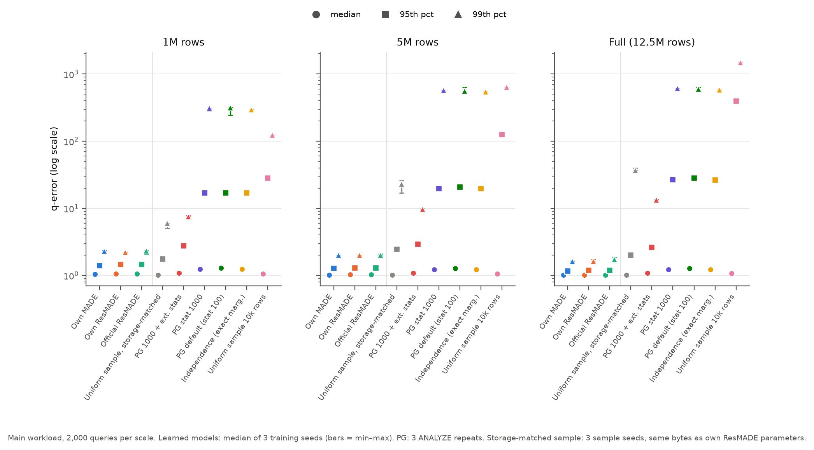

**图 3 误差分布尾部**：每个 x 对应 q-error 超过 x 的查询比例。模型曲线在 q-error 4–10 附近就到底了，基线一直拖到 10³–10⁴。

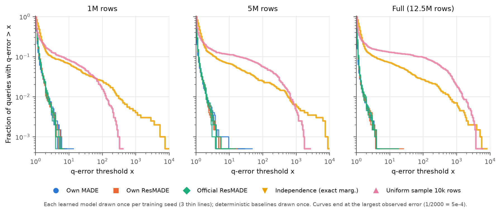

**图 4 自写 vs 官方 ResMADE 逐查询配对**：比值高度集中在 0 附近，规模越大越集中。

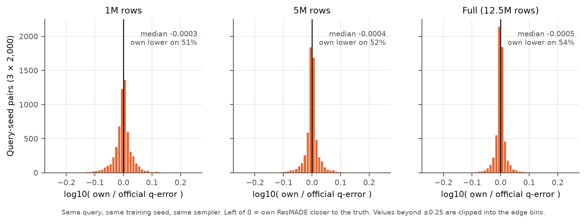

**图 5 按谓词数和真实选择率分组的 p95**：模型在各组都稳定；基线在中低选择率（1e-5 到 1e-2）最差。低选择率组（≤1e-5，约 120–150 条）里模型 p95 升到 2.5–3 左右，是模型主要的误差来源。

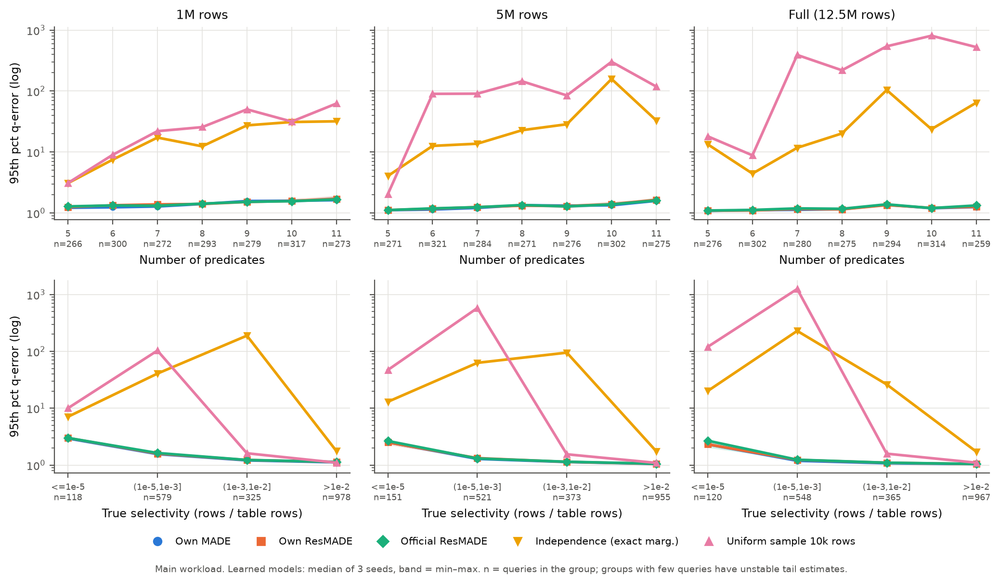

**图 6 精度与代价（全表）**：左图横轴是统计量 / 模型大小，右图横轴是单查询估计时间。

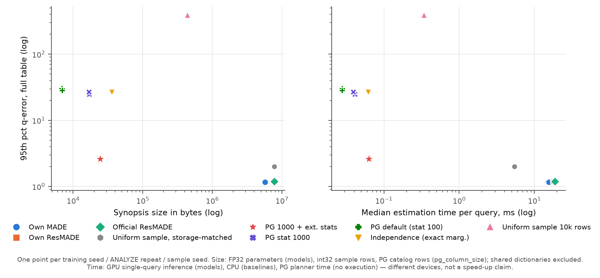

**图 7 不同负载下的 p95**：shared 和 predicate sweep 上的结论与主负载一致。stress v2 不一样：它含大量零结果查询，经 max(1,·) 处理后独立假设反而是 1.00；自写 MADE 在 stress v2 上 p95 约 2.4，两种 ResMADE 只有 1.15–1.5。原因已查明（见附录 B），是采样方式造成的，不是实现错误：MADE 没有列遮盖，不能跳过通配列，对 `fuel_type IS NULL` 这条查询偶尔会漏采，估计几乎为 0。去掉这条查询后，MADE 的 p95 是 1.15–1.31，和 ResMADE 持平。stress v2 只有 64 种不同语义，重复查询不独立，所以只作为辅助证据。

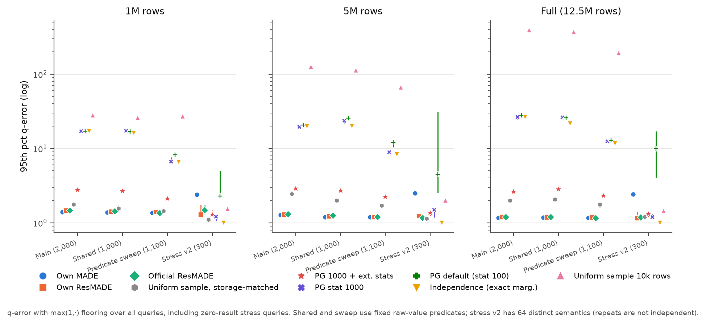

**图 8 采样预算**：自写 ResMADE，样本数 100 → 8000。p95 和 p99 在 2000 之后基本不再下降，延迟在 2000 到 8000 之间翻倍。主实验用 2000 是合理的折中。

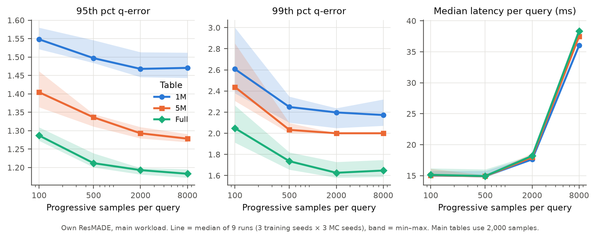

**图 9 模型宽度（1M）**：宽度 128/256/512 时 NLL 单调下降（14.095 → 14.064 → 14.046），p99 也下降，但 p95 不单调（1.49 / 1.46 / 1.48）。NLL 更低不代表尾部误差一定更小。

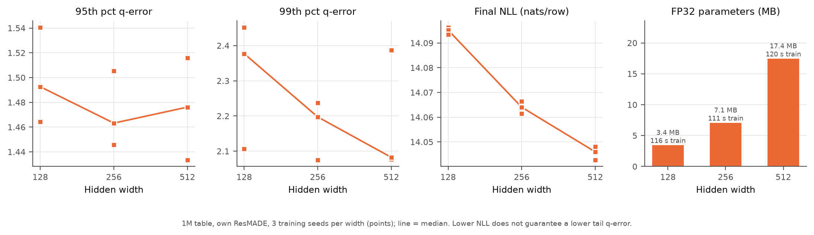

**图 10 joint-zero 负载**：100 对查询，每对是一个稀有的正结果查询，加上只改了一个谓词、联合结果变成 0 的版本（每个谓词单独看仍然能匹配到行）。三个模型对正例的 p95 约 3，99%–100% 的对能排对顺序（正例估计 > 零例估计）；均匀采样对正例大多直接估成 0（同存储采样 58%–92%，10k 采样 95%–99%），排序基本失效；PG 能排对的比例在 29%–60%。这是专门构造的负载，不代表一般查询分布。

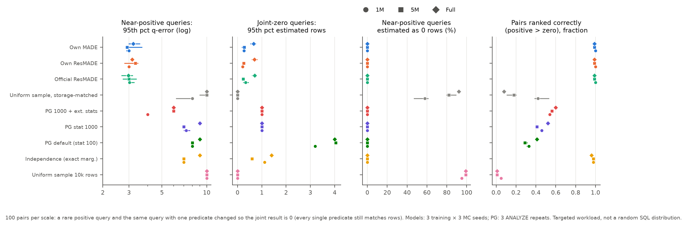

**图 11 规模趋势**：用三个规模都非空的 958 条相同查询。模型的 p95/p99 随规模增大略降；10k 均匀采样和同存储采样的 p99 随规模明显变差（采样比例变小）。

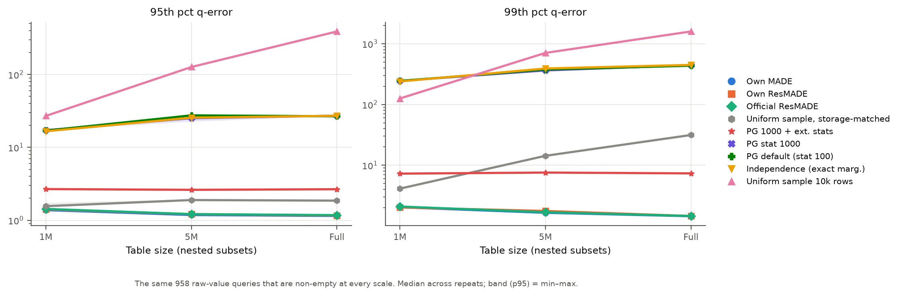

## 4. 改进实验（等待结果）

交接文档：`Naru_Lab_20261109/CODEX_HANDOFF_IMPROVEMENTS.md`，截止 2026-11-23。只改自写 ResMADE，做三项改动的单独消融和三项全开：

| 变体 | 改动 |
|---|---|
| V-order | 列序按训练表两两互信息贪心排序 |
| V-steps | 三个规模统一训练 122,480 步（原来 1M 只有 9,780 步，其中 warmup 就占 82%） |
| V-embed | 域大于 64 的列（reg_valid_date、color）输入改为 32 维 embedding |
| V-all | 三项全开 |

结果到位后，重跑 `python analysis/make_figures.py` 会自动生成 `fig12_improvements`，届时补充本节的表格和结论。

<!-- TODO: 改进结果表、配对胜率、参数量与训练时间变化、负面结果 -->

## 5. 局限（报告里要写）

- 数据快照与论文不同，绝对数字不可比，只比较方法间的相对关系。
- 每个配置只有 3 个训练 seed，范围只是描述性的 min–max。
- 训练 NLL 在训练表上计算，没有独立验证集。
- 延迟：模型是 GPU 单查询，基线是 CPU，PG 只计规划时间，三者不可直接对比。
- 1M 规模在 20 epochs 下步数偏少，可能训练不足（改进实验 V-steps 专门检验这一点）。
- 不支持 wildcard skipping 的模型（MADE）遇到“稀有值且由前序列决定”的谓词时，会因漏采出现极端误差（附录 B）。

## 附录图

**A1 训练资源**：单张 RTX 3090，3 seed 中位数。全表上 ResMADE 约 23 分钟，MADE 约 12 分钟。

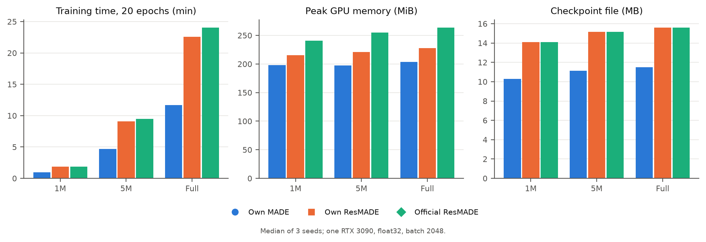

**A2 全表的尾部分组**：真实计数 ≤10 的查询（41 条）和带 “Y” 状态指示的查询（24 条）p95 明显更高。样本少，只作描述。

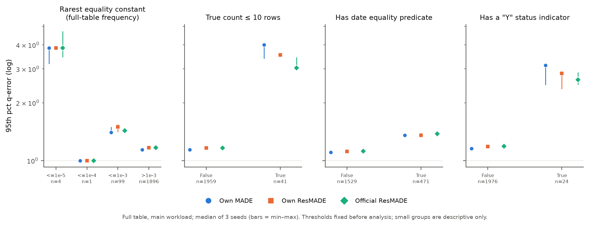

**A3 训练 seed 与 MC seed 带来的波动**：样本数 ≥500 时，多数格子里训练 seed 之间的差异大于同一 checkpoint 内蒙特卡洛的波动（5M 在 2000 样本处两者相当）。

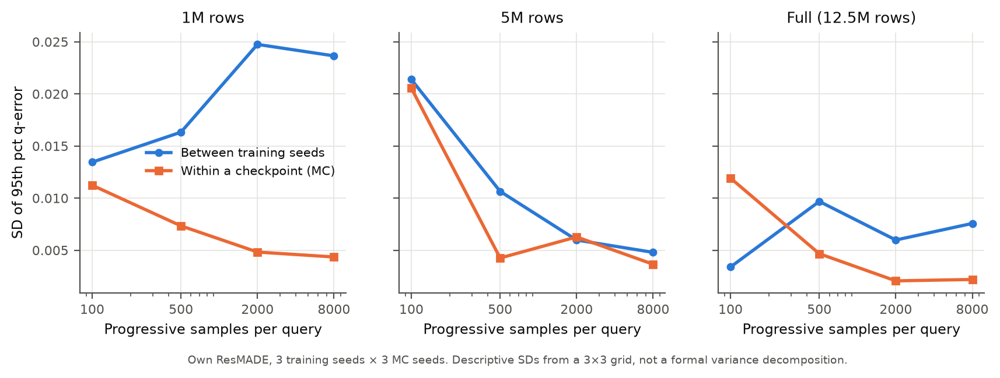

**A4 单查询时间**

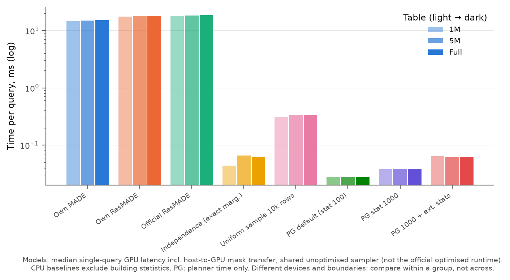

**A5 NLL 与 p95 的关系**：同一规模内，NLL 的差别在 0.01 nats 量级，和 p95 没有稳定关系。

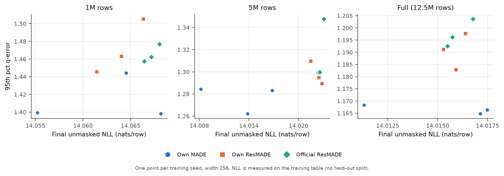

**A6 PostgreSQL 的 ANALYZE 时间与统计信息大小**

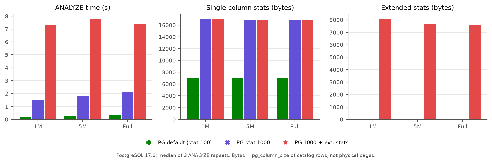

## 附录 B：自写 MADE 在 stress v2 上的异常（2026-11-12 查明）

**现象**：stress v2 上自写 MADE 的 p95 约 2.4，p99 和最大值在全表达到 15,500；两个 ResMADE 的 p95 是 1.15–1.5。

**定位**：几乎全部来自同一条单谓词查询 `fuel_type IS NULL`，它在 stress v2 里重复了 25 次（每次采样种子不同）。全表真值 15,500 行，只占 0.12%。

| 规模 | 真值 | MADE 估计中位数 | MADE 最小估计 | 估计 < 1 行的比例 | ResMADE 最大 q-error |
|---|---:|---:|---:|---:|---:|
| 1M | 1,251 | 2,001 | 0.45 | 1.3% | 1.75（自写）/ 1.44（官方） |
| 5M | 6,295 | 5,000 | 0.003 | 20% | 1.15 / 1.24 |
| 全表 | 15,500 | 12,540 | 0.007 | 20% | 1.41 / 1.29 |

（3 个训练 seed × 25 次重复 = 75 次估计。）

**原因**：

1. MADE 训练时没有列遮盖，推理时不能跳过通配列（summary.json 里 `wildcard_skipping: false`）。查询只约束第 6 列 fuel_type，前 5 列也要从模型里逐个采样。
2. MADE 的估计值几乎全是 N/2000 的整数倍（1M 是 500 行一档，全表是 6,270 行一档）。这说明给定采到的前 5 列后，P(fuel_type=NULL) 要么接近 1、要么接近 0：NULL 燃料几乎只出现在少数稀有的前序取值组合下（推测是船舶、雪地车这类 record_type，原始数据不在本地，没有直接验证）。
3. 所以估计值等于“2000 个样本里有几个落进这个稀有组合”乘以 N/2000，平均只有约 2.5 个样本命中。没有一个命中时估计就几乎为 0，q-error 等于真值。
4. ResMADE 开启 wildcard skipping，前 5 列直接用 MASK 表示、不需要采样，相当于直接读出 fuel_type 的边际分布，所以不受影响。

**影响**：去掉这条查询后，MADE 在 stress v2 上的 p95 分别是 1.31 / 1.21 / 1.15（1M / 5M / 全表），和 ResMADE 一致。主负载的查询都以真实行为锚点，有 5–11 个谓词，前序列大多也被约束，所以不会出现这种情况。

**报告里怎么写**：这正好印证了论文里 wildcard skipping 的作用。可以当作一个“方法局限 + 设计动机”的例子，不需要当成 bug。
