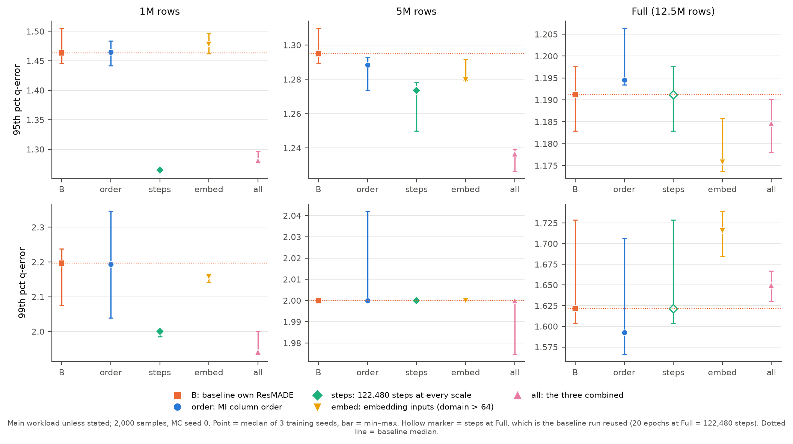
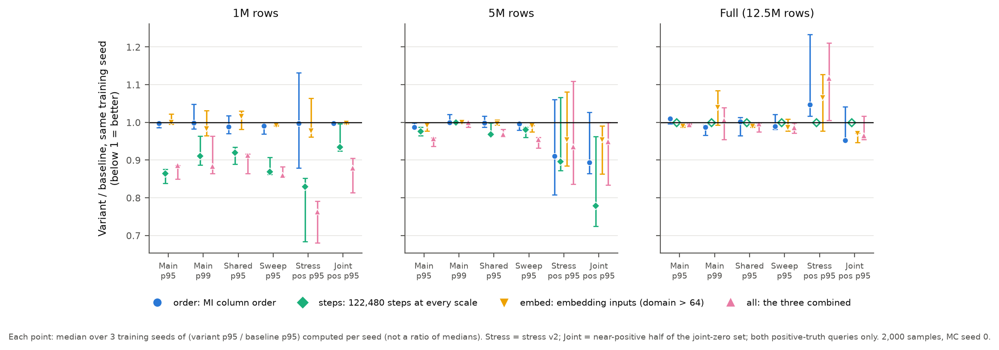
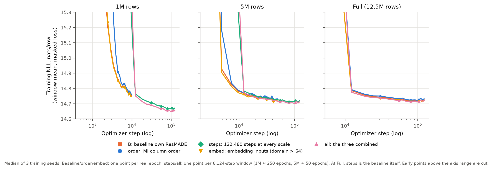
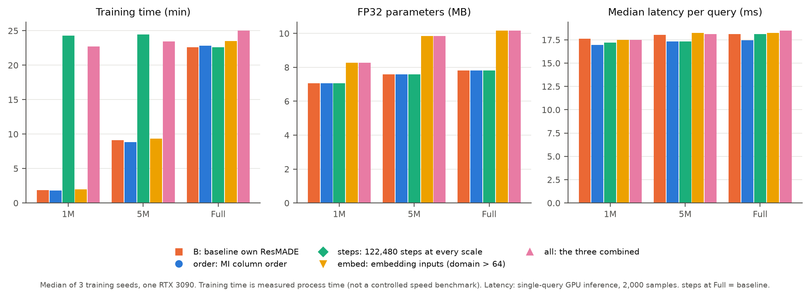
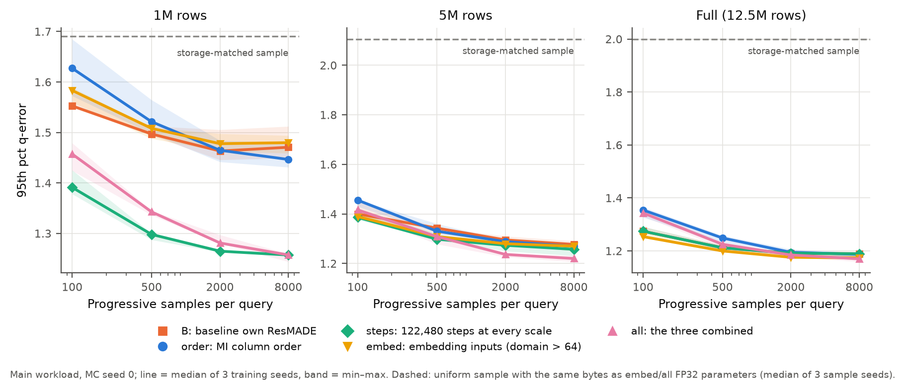
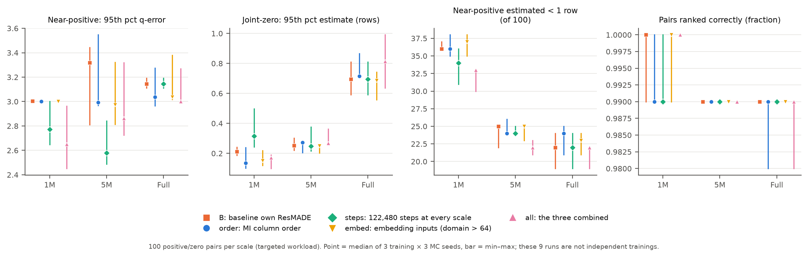

# Naru 复现：结果整理（组内用）

更新：2026-11-13。这份文档给组员写正式报告时参考，不是最终报告。图在 `figures/`（PNG + PDF），每张图实际画出来的数字在 `analysis/tables/<图名>.csv`，脚本是 `analysis/make_figures.py`，一条命令重建：

```bash
python analysis/make_figures.py   # 需要 matplotlib、numpy、pandas；只读 experiments/ 和 data/
```

## 0. 待组员补充

| 项目 | 内容 |
|---|---|
| 成员姓名、本科专业 | TODO |
| 分工 / 贡献 | TODO |
| 视频链接 | TODO（课程要求 5–8 分钟，讲义写 8–10 分钟，录之前再确认） |
| 提交截止 | 2026-12-06 23:59（北京时间），报告文件名 `XXXX-report.pdf` |

## 1. 实验设置（报告里可直接用）

- **数据**：纽约州 DMV 车辆登记表，2026-11-03 版快照，12,540,479 行，论文同款 11 列。原论文链接的快照已失效，所以不能和论文数字直接比较。评估三个规模：前 1M、前 5M 和全表（嵌套子集）。
- **模型**：自写 MADE、自写 ResMADE、官方 ResMADE（上游代码 commit 264cf4e）。宽度 256，5 层，batch 2048，20 epochs，warmup 8000，3 个训练 seed（0/1/2），不早停也不挑 seed。
- **推理**：progressive sampling 2000 个样本；ResMADE 开启 wildcard skipping。
- **基线**：精确边际独立假设、10k 行均匀采样、与自写 ResMADE 参数字节数相同的均匀采样（storage-matched），以及 PostgreSQL 17.6 的三种配置（默认 stat 100、stat 1000、stat 1000 加扩展统计）。
- **负载**：主负载每个规模 2000 条，按官方生成器的方式造查询（以随机行为锚点，5–11 个谓词）。补充负载有 shared 1000、predicate sweep 1100、stress v2 300，以及 joint-zero 100 对。
- **指标**：q-error = max(max(1,真值)/max(1,估计), max(1,估计)/max(1,真值))。每个 seed 先在全部查询上算分位数，再取 3 个 seed 的中位数，误差条是 min–max。**这个范围不是置信区间**，报告里不要写成 95% CI。

## 2. 主要结论

1. **学习型模型把尾部误差降了 1–3 个数量级。** 全表 p99：三个模型在 1.62–1.73 之间；独立假设是 581，10k 均匀采样是 1476，PG 默认配置是 598。
2. **自写 ResMADE 与官方实现基本一致。** 同一查询、同一 seed 逐条配对，log10(自写/官方) 的中位数在 −0.0005 到 −0.0003 之间，自写更准的比例为 51%–54%（图 4）。
3. **ResMADE 并不总比 MADE 好。** 大多数中位数和 p95 格子里 MADE 略优，比如全表 p95 是 1.166 对 1.191。报告里不要写“ResMADE 更强”。
4. **最强的传统基线是 PG 加扩展统计和同存储采样。** 全表 p95 分别为 2.62 和 2.00，差距比独立假设小得多，但 p99（13.4、37.0）仍比模型高一个数量级以上。
5. **代价**：模型约 5.8–7.8 MB 参数，单查询 GPU 推理约 15–18 ms；PG 统计只有几 KB，规划时间低于 0.1 ms（图 6）。两者设备和计时边界都不同，只能说明量级，不能当加速比。

### 主表（主负载，3 seed 中位数）

| 规模 | 方法 | median | p95 | p99 |
|---|---|---:|---:|---:|
| 1M | 自写 MADE | 1.046 | 1.399 | 2.294 |
| 1M | 自写 ResMADE | 1.054 | 1.463 | 2.197 |
| 1M | 官方 ResMADE | 1.060 | 1.462 | 2.330 |
| 1M | 同存储均匀采样 | 1.014 | 1.764 | 6.000 |
| 1M | PG stat1000 + 扩展统计 | 1.087 | 2.772 | 7.502 |
| 1M | PG 默认 | 1.297 | 17.01 | 314.6 |
| 1M | 独立假设 | 1.243 | 17.00 | 294.7 |
| 1M | 10k 均匀采样 | 1.063 | 28.05 | 124.0 |
| 5M | 自写 MADE | 1.017 | 1.283 | 2.000 |
| 5M | 自写 ResMADE | 1.025 | 1.295 | 2.000 |
| 5M | 官方 ResMADE | 1.028 | 1.300 | 2.006 |
| 5M | 同存储均匀采样 | 1.015 | 2.458 | 23.02 |
| 5M | PG stat1000 + 扩展统计 | 1.087 | 2.912 | 9.751 |
| 5M | PG 默认 | 1.281 | 20.67 | 558.0 |
| 5M | 独立假设 | 1.231 | 19.78 | 547.1 |
| 5M | 10k 均匀采样 | 1.065 | 126.2 | 635.1 |
| 全表 | 自写 MADE | 1.017 | 1.166 | 1.622 |
| 全表 | 自写 ResMADE | 1.021 | 1.191 | 1.621 |
| 全表 | 官方 ResMADE | 1.023 | 1.196 | 1.734 |
| 全表 | 同存储均匀采样 | 1.016 | 2.000 | 37.00 |
| 全表 | PG stat1000 + 扩展统计 | 1.084 | 2.616 | 13.39 |
| 全表 | PG 默认 | 1.277 | 28.03 | 598.4 |
| 全表 | 独立假设 | 1.226 | 26.46 | 581.0 |
| 全表 | 10k 均匀采样 | 1.066 | 393.3 | 1476 |

PG stat 1000（不加扩展统计）和 PG 默认差不多，完整数字见 `analysis/tables/fig02_main_accuracy.csv`。

## 3. 正文图

**图 1 训练曲线**：三个规模、三种模型的每轮训练 NLL。注意 ResMADE 的 loss 里含随机列遮盖，和 MADE 的目标函数不同，两族曲线不能直接比高低。


**图 2 主负载精度**：所有方法的 median / p95 / p99，对数坐标。竖线左边是三个模型。


**图 3 误差分布尾部**：每个 x 对应 q-error 超过 x 的查询比例。模型曲线在 q-error 4–10 附近就到底了，基线一直拖到 10³–10⁴。


**图 4 自写 vs 官方 ResMADE 逐查询配对**：比值高度集中在 0 附近，规模越大越集中。


**图 5 按谓词数和真实选择率分组的 p95**：模型在各组都稳定；基线在中低选择率（1e-5 到 1e-2）最差。低选择率组（≤1e-5，约 120–150 条）里模型 p95 升到 2.5–3 左右，是模型主要的误差来源。


**图 6 精度与代价（全表）**：左图横轴是统计量 / 模型大小，右图横轴是单查询估计时间。


**图 7 不同负载下的 p95**：shared 和 predicate sweep 上的结论与主负载一致。stress v2 不一样：它含大量零结果查询，经 max(1,·) 处理后独立假设反而是 1.00；自写 MADE 在 stress v2 上 p95 约 2.4，两种 ResMADE 只有 1.15–1.5。原因已查明（见附录 B），是采样方式造成的，不是实现错误：MADE 没有列遮盖，不能跳过通配列，对 `fuel_type IS NULL` 这条查询偶尔会漏采，估计几乎为 0。去掉这条查询后，MADE 的 p95 是 1.15–1.31，和 ResMADE 持平。stress v2 只有 64 种不同语义，重复查询不独立，所以只作为辅助证据。


**图 8 采样预算**：自写 ResMADE，样本数 100 → 8000。p95 和 p99 在 2000 之后基本不再下降，延迟在 2000 到 8000 之间翻倍。主实验用 2000 是合理的折中。


**图 9 模型宽度（1M）**：宽度 128/256/512 时 NLL 单调下降（14.095 → 14.064 → 14.046），p99 也下降，但 p95 不单调（1.49 / 1.46 / 1.48）。NLL 更低不代表尾部误差一定更小。


**图 10 joint-zero 负载**：100 对查询，每对是一个稀有的正结果查询，加上只改了一个谓词、联合结果变成 0 的版本（每个谓词单独看仍然能匹配到行）。三个模型对正例的 p95 约 3，99%–100% 的对能排对顺序（正例估计 > 零例估计）；均匀采样对正例大多直接估成 0（同存储采样 58%–92%，10k 采样 95%–99%），排序基本失效；PG 能排对的比例在 29%–60%。这是专门构造的负载，不代表一般查询分布。


**图 11 规模趋势**：用三个规模都非空的 958 条相同查询。模型的 p95/p99 随规模增大略降；10k 均匀采样和同存储采样的 p99 随规模明显变差（采样比例变小）。


## 4. 改进实验（已完成，2026-11-12）

只改自写 ResMADE，固定消融：三项改动各单独做一次，再做一次三项全开。每个变体 × 3 个规模 × 3 个训练 seed，共 33 次新训练；steps 在 full 上本来就是 122,480 步，直接复用基线，不重训。原始数据、配置和审计在 `experiments/improvement_20261111/`（`FINAL_ANALYSIS.md` 是 Codex 的完整分析，`analysis/` 下是汇总 CSV），`scripts/analyze_improvements.py` 可以从原始 CSV 重建全部汇总（本地重跑结果为 PASS_COMPLETE，数值与服务器一致）。

| 变体 | 改动 |
|---|---|
| B | 基线自写 ResMADE（第 2 节的模型） |
| order | 列序按训练表两两互信息贪心排序，三个规模用同一顺序 `[1,4,0,5,7,6,3,2,9,8,10]` |
| steps | 三个规模统一训练 122,480 步（1M 约 250 个真实 epoch，5M 约 50 个；原来 1M 只有 9,780 步） |
| embed | 域大于 64 的列输入改为 32 维 embedding（1M 2 列，5M/full 4 列，多了 registration_class 和 state） |
| all | 三项全开 |

### 主负载 p95（3 个训练 seed 的中位数 [min–max]，2000 samples，MC seed 0）

| 变体 | 1M | 5M | full |
|---|---|---|---|
| B | 1.4632 [1.4456–1.5054] | 1.2949 [1.2893–1.3099] | 1.1912 [1.1829–1.1977] |
| order | 1.4647 [1.4417–1.4839] | 1.2884 [1.2737–1.2927] | 1.1946 [1.1935–1.2064] |
| steps | **1.2648** [1.2626–1.2662] | 1.2735 [1.2500–1.2781] | 1.1912（复用 B） |
| embed | 1.4777 [1.4624–1.4974] | 1.2798 [1.2794–1.2917] | **1.1758** [1.1737–1.1858] |
| all | 1.2810 [1.2800–1.2970] | **1.2366** [1.2264–1.2394] | 1.1846 [1.1780–1.1902] |

同一训练 seed 内算 p95 / B，再取三个 seed 的中位数：steps 为 0.864 / 0.976 / 1.000，all 为 0.886 / 0.957 / 0.994（1M / 5M / full）。注意“比值的中位数”不等于“中位数之比”，例如 embed/1M 的 p95 中位数高于 B，但配对比值中位数是 0.9994。

结论：

- **收益主要来自小规模增加训练步数。** 1M 上 steps 把 p95 降了约 14%，说明原来 20 epochs 在 1M 训练不足。
- **三项全开在三个规模的主 p95 都低于 B**，但 1M 不如单独 steps，full 只降约 0.6%；不能说三项收益可以相加。
- **order 单独基本没有作用**（比值都在 0.99–1.01）；**embed 只在 full 上 p95 有改善**。
- 没有哪个变体在全部指标上都更好（见下面的负面结果）。

### 成本

| | 1M | 5M | full |
|---|---|---|---|
| steps 训练时间 / B | 13.11× | 2.68× | 1.00× |
| all 训练时间 / B | 12.03× | 2.58× | 1.09× |
| embed、all 参数字节增加 | +17.1% | +29.8% | +30.1% |
| all 训练 NLL 降低（nats） | 0.192 | 0.034 | 0.009 |

训练时间是实测进程时间，没有做严格控制的速度实验。NLL 是在训练表上算的，不是独立验证集。单查询延迟各变体差别不大（约 17–19 ms，GPU，2000 samples）。

### 采样数与同存储采样

all 在 MC seed 0 下，p95 随每条查询的 progressive samples 100 → 500 → 2000 → 8000 变化：

| 规模 | 100 | 500 | 2000 | 8000 |
|---|---|---|---|---|
| 1M | 1.4573 | 1.3426 | 1.2810 | 1.2572 |
| 5M | 1.4162 | 1.3084 | 1.2366 | 1.2200 |
| full | 1.3431 | 1.2249 | 1.1846 | 1.1698 |

2000 → 8000 时 all 的 27 格全部改善，延迟约 2.23×；但 order 有 1 格、embed 有 4 格 p95 轻微变差，所以多采样不保证每个分位数都变好。

同存储对照：用和 embed/all FP32 参数相同的字节数存一个均匀样本（1M / 5M / full 分别能存 187,848 / 223,951 / 231,095 行），主负载 p95 为 1.69 / 2.11 / 2.00，明显差于 all 的 1.28 / 1.24 / 1.18；采样延迟约 6.4–8.0 ms，比模型快（硬件不同，不能当成硬件无关的速度倍数）。

### 负面结果（报告里要写）

- **full 的尾部变差**：embed 和 all 的主 p95 三个 seed 都下降，但各有 2 个 seed 的 p99 高于 B（例如 embed/seed0 从 1.604 升到 1.739）。
- **压力负载变差**：full 的 stress v2 正例 p95 / B 为 order 1.048、embed 1.065、all 1.117。主负载上的改善不能外推到所有查询。
- **joint-zero**：full、MC0 下 all 的正例 p95 为 3.001，低于 B 的 3.145；但零例估计的 p95 从 0.695 升到 0.815，仍有 22/100 个正例被估成不足 1 行；正例/零例排对的比例都是 99%。

### 解释边界

旧结果被用来提出这几项改进，这一轮不是在没见过的测试集上做的确认性验证；四个变体也不是完整的析因设计，不能把交互作用分别归因。3 个 seed 的 min–max 只是描述，不是置信区间。

### 图

**图 12 主负载 p95/p99**（虚线 = B 的中位数，空心 = full 上复用 B 的 steps）：



**图 13 各负载配对比值**（每个 seed 内 变体/B，取中位数，低于 1 更好；stress 和 joint 只看正例）：



**图 14 训练曲线**（横轴是优化器步数，对数刻度；steps/all 每点是 6,124 步的窗口均值，和 B 的“每 epoch 一个点”不是同一种横轴单位）：



**图 15 成本**（训练时间、参数大小、单查询延迟）：



**图 16 采样数**（灰虚线 = 同存储均匀样本）：



**图 17 joint-zero**（3 训练 seed × 3 MC seed 的中位数和范围，这 9 次不是独立训练）：



## 5. 局限（报告里要写）

- 数据快照与论文不同，绝对数字不可比，只比较方法间的相对关系。
- 每个配置只有 3 个训练 seed，范围只是描述性的 min–max。
- 训练 NLL 在训练表上计算，没有独立验证集。
- 延迟：模型是 GPU 单查询，基线是 CPU，PG 只计规划时间，三者不可直接对比。
- 1M 规模在 20 epochs 下训练不足：统一到 122,480 步后 1M 主 p95 降约 14%（第 4 节）。第 2 节主表里 1M 的模型数字因此偏保守。
- 不支持 wildcard skipping 的模型（MADE）遇到“稀有值且由前序列完全决定”的谓词时（例如 fuel_type 为 NULL 当且仅当 record_type=SNOW），会因漏采出现极端误差（附录 B）。

## 附录图

**A1 训练资源**：单张 RTX 3090，3 seed 中位数。全表上 ResMADE 约 23 分钟，MADE 约 12 分钟。


**A2 全表的尾部分组**：真实计数 ≤10 的查询（41 条）和带 “Y” 状态指示的查询（24 条）p95 明显更高。样本少，只作描述。


**A3 训练 seed 与 MC seed 带来的波动**：样本数 ≥500 时，多数格子里训练 seed 之间的差异大于同一 checkpoint 内蒙特卡洛的波动（5M 在 2000 样本处两者相当）。


**A4 单查询时间**


**A5 NLL 与 p95 的关系**：同一规模内，NLL 的差别在 0.01 nats 量级，和 p95 没有稳定关系。


**A6 PostgreSQL 的 ANALYZE 时间与统计信息大小**


## 附录 B：自写 MADE 在 stress v2 上的异常（2026-11-12 查明）

**现象**：stress v2 上自写 MADE 的 p95 约 2.4，p99 和最大值在全表达到 15,500；两个 ResMADE 的 p95 是 1.15–1.5。

**定位**：几乎全部来自同一条单谓词查询 `fuel_type IS NULL`，它在 stress v2 里重复了 25 次（每次采样种子不同）。全表真值 15,500 行，只占 0.12%。

| 规模 | 真值 | MADE 估计中位数 | MADE 最小估计 | 估计 < 1 行的比例 | ResMADE 最大 q-error |
|---|---:|---:|---:|---:|---:|
| 1M | 1,251 | 2,001 | 0.45 | 1.3% | 1.75（自写）/ 1.44（官方） |
| 5M | 6,295 | 5,000 | 0.003 | 20% | 1.15 / 1.24 |
| 全表 | 15,500 | 12,540 | 0.007 | 20% | 1.41 / 1.29 |

（3 个训练 seed × 25 次重复 = 75 次估计。）

**原因**：

1. MADE 训练时没有列遮盖，推理时不能跳过通配列（summary.json 里 `wildcard_skipping: false`）。查询只约束第 6 列 fuel_type，前 5 列也要从模型里逐个采样。
2. MADE 的估计值几乎全是 N/2000 的整数倍（1M 是 500 行一档，全表是 6,270 行一档）。这说明给定采到的前 5 列后，P(fuel_type=NULL) 要么接近 1、要么接近 0。
3. **已在冻结快照上验证**（`dmv.csv`，12,540,479 行，用 pandas 直接统计）：fuel_type 为 NULL 的 15,500 行**恰好就是** record_type=SNOW（雪地车）的全部 15,500 行。这些行的 registration_class 都是 SNO，body_type 都是 SNOW；BOAT、TRL、VEH 三类的 NULL 燃料都是 0 行。按前 5 列分组，共有 144 种组合含 NULL 燃料，组内 P(NULL) 都是 1.0。所以只要采到的第一列是 SNOW，第 6 列就一定是 NULL；采不到就是 0。
4. 因此估计值等于“2000 个样本里第一列采到 SNOW 的个数”乘以 N/2000。按真实比例 0.124% 算，期望约 2.5 个样本命中；MADE 在全表和 5M 上的平均估计相当于 2.0 个，1M 上相当于 4.2 个。没有一个命中时估计就几乎为 0，q-error 等于真值。全表和 5M 上，25 次重复中有 5 次落空，按泊松分布（均值 2.0）预期约 13.5%，即 3–4 次，在 25 次的抽样误差范围内。
5. 三个训练 seed 在 5M 和全表上落空的是同样 5 次，平均估计也一样。这是因为采样种子在不同训练 seed 之间是共享的（100000 + 查询序号），而各 seed 的模型对 P(SNOW) 的估计足够接近，同一组随机数落在相同的区间里。所以这条查询上 3 个 seed 并不是独立的 3 次观测。
6. ResMADE 开启 wildcard skipping，前 5 列直接用 MASK 表示、不需要采样，相当于直接读出 fuel_type 的边际分布，所以不受影响。

**影响**：去掉这条查询后，MADE 在 stress v2 上的 p95 分别是 1.31 / 1.21 / 1.15（1M / 5M / 全表），和 ResMADE 一致。主负载的查询都以真实行为锚点，有 5–11 个谓词，前序列大多也被约束，所以不会出现这种情况。

**报告里怎么写**：这正好印证了论文里 wildcard skipping 的作用。可以当作一个“方法局限 + 设计动机”的例子，不需要当成 bug。
